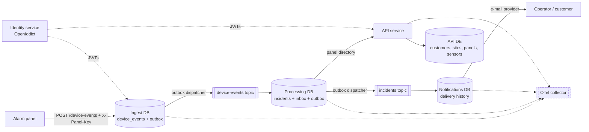

# AlarmHub

Alarm lifecycle platform for a security company: customers, protected sites, alarm panels,
device telemetry, incidents and operator notifications, built as an event-driven .NET 10
microservice system.

The project is a portfolio piece that mirrors a real alarm-business domain (panels, zones,
tamper faults, monitoring) and demonstrates the engineering practices behind it: transactional
outbox, idempotent consumers, dead-lettering, scope-based authorization, OpenTelemetry tracing
across a broker hop and Testcontainers-based tests.

## Architecture



Every service owns its database. Nothing is shared except the integration contracts in
`AlarmHub.Contracts`; cross-service reads go through the API's internal directory endpoint.

## Services

| Service | Responsibility | Database |
|---|---|---|
| `AlarmHub.Api` | Customers → sites → panels → sensors, panel API keys, incident queries | `alarmhub_api` |
| `AlarmHub.Ingest` | Accepts device telemetry, verifies panel keys, stores raw events, publishes `DeviceEventReceivedV1` | `alarmhub_ingest` |
| `AlarmHub.Processing` | Rules engine: turns events into incidents, publishes `IncidentOpenedV1` | `alarmhub_processing` |
| `AlarmHub.Notifications` | Delivers incident alerts, records delivery history | `alarmhub_notifications` |
| `AlarmHub.Identity` | OAuth 2.0 token endpoint (OpenIddict), scopes `alarms.read`, `alarms.write`, `devices.ingest` | `alarmhub_identity` |
| `AlarmHub.Contracts` | Versioned integration events shared by all services | — |

## How the reliability patterns fit together

- **Idempotency.** `DeviceEventRecord.EventId` is the primary key, so a retrying panel gets `200 duplicate`
  instead of a second row. Processing keeps an inbox table for the same reason.
- **Transactional outbox.** The business row and the pending integration event are committed in one
  `SaveChanges`; a background dispatcher publishes and stamps the row. No dual writes, no lost events.
- **Dead-lettering.** Unknown panels and unreadable bodies are dead-lettered with a reason instead of
  being retried forever.
- **Tracing.** The outbox row stores the W3C `traceparent`, the dispatcher resumes it before publishing
  and consumers continue it, so one trace covers `ingest → processing → notifications`.
- **Authorization.** Tokens are validated against the identity service (or Auth0 via `Auth:Authority`);
  endpoints require the narrowest scope they need.

## Run it locally

Prerequisites: .NET 10 SDK, Docker Desktop.

```bash
# Postgres + SQL Edge + Service Bus emulator + OTel collector
docker compose up -d

# Build and start the five services against the emulator
pwsh scripts/dev/run-local.ps1
```

Then exercise the pipeline:

```bash
pwsh scripts/dev/scenario.ps1        # customer -> site -> panel -> sensor -> device event
pwsh scripts/dev/verify-pipeline.ps1 # incidents, notifications and outbox rows from Postgres
pwsh scripts/dev/get-token.ps1       # client-credentials token from the identity service
pwsh scripts/dev/fire-alarm.ps1      # one alarm, to follow a single trace
```

Endpoints:

| Endpoint | Auth | Purpose |
|---|---|---|
| `POST /api/customers`, `GET /api/customers/{id}` | `alarms.write` / `alarms.read` | Customer registry |
| `POST /api/sites`, `GET /api/sites/{id}` | `alarms.write` / `alarms.read` | Protected sites |
| `POST /api/panels`, `GET /api/panels/{id}`, `POST /api/panels/{id}/sensors` | `alarms.write` / `alarms.read` | Hardware and zones |
| `POST /device-events` (ingest) | `X-Panel-Key` header | Panel telemetry |
| `POST /connect/token` (identity) | client credentials | Access tokens |
| `/health/live`, `/health/ready` | anonymous | Probes |

## Tests

```bash
dotnet test AlarmHub.slnx
```

- **Unit** — alarm policy and domain invariants (36 assertions in total).
- **Architecture** — contracts must not depend on infrastructure, domain must not reach into EF Core.
- **Integration** — API and ingest booted against throwaway PostgreSQL containers; idempotency and
  HTTP contracts verified over real HTTP.

## Configuration

| Key | Purpose |
|---|---|
| `ConnectionStrings:AlarmHub`, `:Ingest`, `:Processing`, `:Notifications`, `:Identity` | Per-service databases |
| `ConnectionStrings:ServiceBus` | Emulator or Azure Service Bus; empty means the log publisher is used |
| `Auth:Authority`, `Auth:Audience` | Local issuer or Auth0 tenant |
| `Identity:DemoClientSecret` | Secret for the seeded demo client (development only) |
| `OpenTelemetry:Endpoint` | OTLP collector endpoint |

## Roadmap

- React + TypeScript operations console (live incidents, incident timeline).
- Authorization-code flow and a customer portal on top of the identity service.
- EF migrations in the deployment pipeline (development currently uses `EnsureCreated`).
- Azure deployment: Container Apps, Service Bus, Key Vault for signing certificates.
